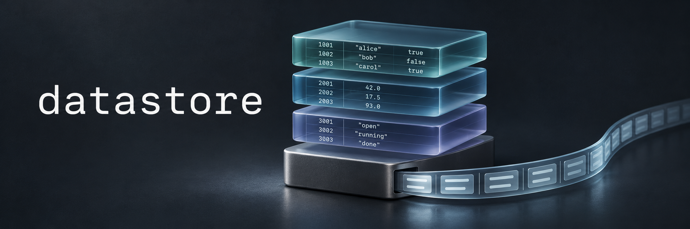

[](https://github.com/keshon/datastore/actions/workflows/ci.yml) [](https://pkg.go.dev/github.com/keshon/datastore)

# datastore

An embedded Go store for small datasets that fit comfortably in RAM. Typed
collections and indexes are declared in Go; atomic transactions can update
several collections together. Records are held as JSON in memory and persisted
through a write-ahead log and snapshots.

The default `SyncAlways` mode flushes commits before `Update` returns successfully.
Concurrent commits can share a flush. Power-loss recovery depends on the
filesystem and storage honoring sync. Windows snapshot installation requests
write-through but has no explicit directory-sync barrier. See the
[durability contract](docs/internals.md#durability-per-database).

## When to use it

Use datastore for local application state, a CLI database, or a single-node
service whose data fits in memory and needs atomic updates across records.
It provides multi-valued, unique and sorted indexes, schema migrations,
recovery reports, retained audit history and a best-effort change feed.

There is no SQL, joins, MVCC, replication or multi-process writing. One process
owns the directory for writing; another can load a
[read-only view](docs/guide.md#reading-from-a-second-process). Reads return fresh
copies. Indexes are rebuilt at startup. Compaction streams the snapshot while
writers wait; readers can proceed during snapshot encoding and I/O. Measure
capacity with your own records and indexes.

## Install

Requires Go 1.25.0 or newer, following [go.mod](go.mod). From your application module:

```sh
go get github.com/keshon/datastore
```

## Quickstart

Save this as `main.go` in your application module and run `go run .`. It creates
`data/main` relative to your working directory; subsequent runs reopen it and
add another order. Declare collections and indexes before opening the database.

```go
package main

import (
    "fmt"
    "log"
    "strconv"

    "github.com/keshon/datastore"
)

type Order struct {
    ID       uint64 `json:"id"`
    Customer string `json:"customer"`
}

func (o *Order) Key() string { return strconv.FormatUint(o.ID, 10) }

func main() {
    if err := run(); err != nil {
        log.Fatal(err)
    }
}

func run() (err error) {
    db := datastore.New(datastore.Options{Dir: "data/main"})
    orders := datastore.Register[*Order](db, "orders")
    byCustomer := datastore.AddIndex(orders, "customer",
        func(o *Order) []string { return []string{o.Customer} })
    if err := db.Open(); err != nil {
        return err
    }
    defer func() {
        if closeErr := db.Close(); err == nil {
            err = closeErr
        }
    }()

    if rep := db.Recovery(); rep.LostData() {
        return fmt.Errorf("recovery reported possible data loss: %+v", rep)
    }
    if err := db.Update(func(tx *datastore.Tx) error {
        return datastore.In(tx, orders).Put(&Order{
            ID: tx.NextID("order"), Customer: "cust-7",
        })
    }); err != nil {
        return err
    }
    fmt.Println("orders for cust-7:", len(byCustomer.Find("cust-7")))
    return nil
}
```

Inside `Update` or `View`, use the transaction-scoped `In*` methods. Direct
collection methods can reacquire locks or start nested transactions; follow
the [concurrency rules](docs/guide.md#concurrency-what-may-be-called-from-where).

For a larger runnable example with multiple collections and all three index
types, run this from a checkout of this repository:

```sh
go run ./examples/orders
```

That example uses a temporary database and removes it when finished.

## Documentation

- [Running and using datastore](docs/guide.md) — configuration, collections,
  transactions, concurrency, migrations, recovery, history, watches and backup.
- [Internals](docs/internals.md) — state ownership, disk format, commit flow
  and durability limits.
- [Development conventions](docs/conventions.md) — local checks, CI and
  implementation contracts.
- [API reference](https://pkg.go.dev/github.com/keshon/datastore) — exported types
  and methods; source declarations define defaults and contracts.
- [Historical measurements](docs/internal/measurements.md) — previously published
  estimates and commands for measuring the current implementation.
- [GEKTOR storage assessment, 2026-11-13](docs/internal/2026-11-13-gektor-storage-assessment.md)
  — reproduced concurrent unique-index defect and application fit assessment.

## License

MIT — see [LICENSE](LICENSE).
